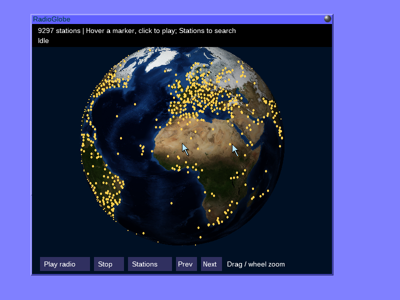
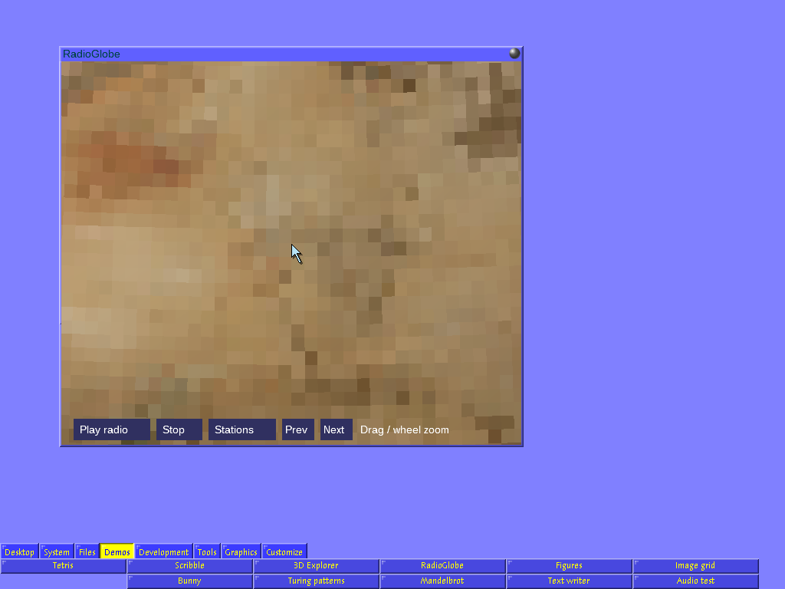
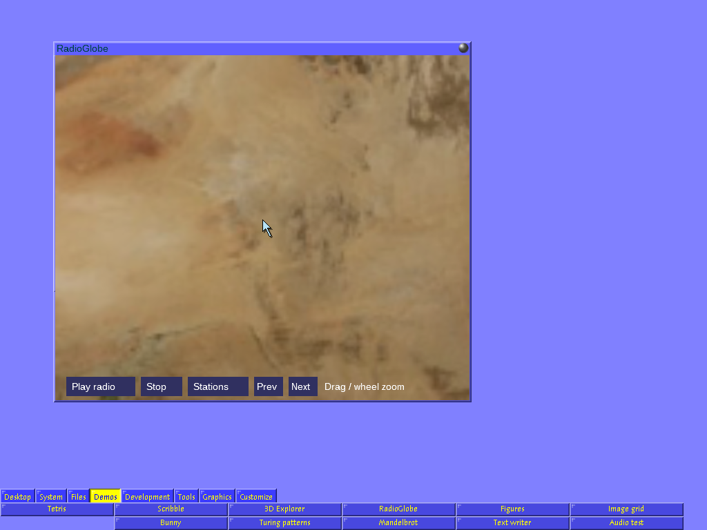

## Active Object System (AOS aka A2) git repository (from 9.12.2022)

An experimental native Apple Silicon desktop port is documented in
[RELEASE-DARWIN-AARCH64.md](RELEASE-DARWIN-AARCH64.md). It was developed with
substantial assistance from OpenAI Codex under the direction and testing of an
Active Oberon enthusiast; it is an independent preview, not an ETH release.

### RadioGlobe on macOS

The native Apple Silicon desktop includes RadioGlobe, based on
[David Leimbach's 9front application](https://github.com/leimy/radioglobe), with
9,297 catalogue stations, globe markers, station search and native audio playback.
Open **Demos → RadioGlobe**; drag to rotate, use the wheel to zoom, and click a
marker to play. **Stations** opens the searchable catalogue. Playback supports
MP3, AAC/AAC+, Opus and native/Ogg FLAC, plus Ogg Vorbis.

[**Watch the RadioGlobe demo**](https://github.com/Leimy/A2-Drawterm-MacOS/releases/download/radioglobe-demo-2026-11-13/radioglobe-demo.mp4)
— 16 seconds, 60 fps capture, silent H.264 MP4, about 4 MB. The clip shows rotation, inertia,
station markers and zoom, recorded from A2's drawterm/9P framebuffer.

[](https://github.com/Leimy/A2-Drawterm-MacOS/releases/download/radioglobe-demo-2026-11-13/radioglobe-demo.mp4)

The current source build improves close zoom with **bilinear filtering written
in Active Oberon**, a **4096×2048 Earth texture**, and interpolated angle lookup
tables. The texture wraps across the longitude seam and clamps at the poles.
These captures show the same view and zoom before and after the change:

| Previous nearest-neighbor rendering | Filtered high-resolution rendering |
| --- | --- |
|  |  |

The larger texture uses about 32 MiB decoded. On the development Mac, sampled
full-quality deep-zoom frames in a 600×500 viewport took a median 58.5 ms,
compared with 35 ms before. Rotation retains the faster preview path and restores
full detail when motion stops. Filtering smooths magnification; detail remains
limited by the source image's resolution.

See [native build and desktop instructions](README-native-desktop.md) for building,
launching, controls and verification. These changes are in the source build;
older preview downloads may not include them.

In order to run A2 on your Windows- or Linux-based system, clone this repository and unzip the appropriate binary within the repository. Example (Linux, AMD64):
```
git clone https://gitlab.inf.ethz.ch/felixf/oberon.git
cd oberon
unzip Linux64
Linux64/a2.sh
```
Note that in order to keep size of the repository reasonable, we do not commmit binary files directly into the git repository. Instead, we use the large file storage (LFS) support of gitlab in order to keep these files out of local git storage of your computer. 

If you cannot or do not want to install LFS for git, you need to download the corresponding zip file from this gitlab website because then git is downloading only a stub of the files. You can identify this with file sizes: if the zip files in the root directory of this project are a few bytes small, then you do not have lfs installed.

Please inform me, if you need developer-access to the repository, if you observe missing files, or if you, in general, want to help setting this up.

## Active Object System (AOS aka A2) SVN repository (before 9.12.2022)

Unregistered users can download the A2 system from the repository located at https://svn-dept.inf.ethz.ch/svn/lecturers/a2/trunk using svn (read only access as user "infsvn.anonymous" using password "anonymous")

To checkout the trunk, use
<pre>
svn checkout --username infsvn.anonymous --password anonymous https://svn-dept.inf.ethz.ch/svn/lecturers/a2/trunk aos
</pre>

## Build Server

The previously existing build-server is being replaced by the CI/CD pipeline in this gitlab. Currently, the pipeline builds the binaries for each commit in a zip file. The zip-files comprise the most-recent binaries and can be downloaded from the pipeline artifacts. More tests will follow. 
